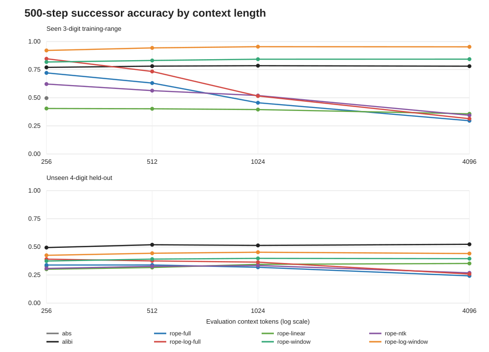

# Completed 500-step context-retention analysis

**Assessment: NO-GO for claiming useful distant-context retrieval.** The
completed benchmark shows substantial task- and position-dependent differences,
but its next-successor task does not establish that correct predictions depend
on retrieving information from far back in the context. The separate planted
needle sanity check failed the pre-existing gate, so no successful retrieval
claim is supported.

## Experiment identity and integrity

- Decision-grade cohort: hosted **Stage 1 context ability 500** workflow,
  [run 43780419668](https://github.com/Slangy0-AFK/zeta-scaling-toolkit/actions/runs/43780419668),
  commit [`d58685833085b45c41d78f10fa3e3d6150e1a773`](https://github.com/Slangy0-AFK/zeta-scaling-toolkit/commit/d58685833085b45c41d78f10fa3e3d6150e1a773).
- Reporting data: [successor records](./context-ability-successor500-hosted.jsonl),
  80 rows, 8 methods × 10 reporting seeds (42–51),
  no missing or duplicate method/seed keys.
- Tuning data: [successor tuning records](./context-ability-successor-tuning500-hosted.jsonl),
  160 rows, 8 methods × 2 candidates × 10 separate tuning seeds (100–109).
- Protocol: 500 optimization steps, train length
  256, batch size 16, 8
  evaluation samples per seed; Python 3.14.10, PyTorch 2.15.0+cpu, one thread.
- Reporting candidates selected on tuning seeds:

| Method | Candidate index |
|---|---:|
| abs | 1 |
| rope-full | 0 |
| rope-linear | 1 |
| rope-ntk | 1 |
| alibi | 0 |
| rope-log-full | 0 |
| rope-window | 0 |
| rope-log-window | 0 |

The two tuning candidates per method, with settings copied from the raw tuning
records:

| Method | Candidate 0 settings | Candidate 1 settings |
|---|---|---|
| abs | `{"learning_rate":0.0007,"rope_scale":1.0,"tau0":10.0}` | `{"learning_rate":0.001,"rope_scale":1.0,"tau0":10.0}` |
| rope-full | `{"learning_rate":0.0007,"rope_scale":1.0,"tau0":10.0}` | `{"learning_rate":0.001,"rope_scale":1.0,"tau0":10.0}` |
| rope-linear | `{"learning_rate":0.001,"rope_scale":4.0,"tau0":10.0}` | `{"learning_rate":0.001,"rope_scale":16.0,"tau0":10.0}` |
| rope-ntk | `{"learning_rate":0.001,"rope_scale":4.0,"tau0":10.0}` | `{"learning_rate":0.001,"rope_scale":16.0,"tau0":10.0}` |
| alibi | `{"learning_rate":0.0007,"rope_scale":1.0,"tau0":10.0}` | `{"learning_rate":0.001,"rope_scale":1.0,"tau0":10.0}` |
| rope-log-full | `{"learning_rate":0.001,"rope_scale":1.0,"tau0":5.0}` | `{"learning_rate":0.001,"rope_scale":1.0,"tau0":10.0}` |
| rope-window | `{"learning_rate":0.0007,"rope_scale":1.0,"tau0":10.0}` | `{"learning_rate":0.001,"rope_scale":1.0,"tau0":10.0}` |
| rope-log-window | `{"learning_rate":0.001,"rope_scale":1.0,"tau0":5.0}` | `{"learning_rate":0.001,"rope_scale":1.0,"tau0":10.0}` |

- Two successor evaluation partitions are kept distinct. `3_digit_train_range_cyclic`
  is numbers 100–999 repeated twice and is seen/training-range. `4_digit_held_out`
  is numbers 1,000–2,999, held out from training but reused across tuning and
  reporting; disjoint seeds do not make the number-range samples independent.
- The records contain no per-record immutable experiment manifest or source
  digest. The linked Actions run and commit identify the workflow/code version;
  source/environment provenance is therefore less complete than a manifest-backed
  run. [Hardware metadata](./context-ability-hosted-hardware.json) shows multiple
  CPU models; the paired intervals below pair by seed, not by identical CPU.

Hosted report platform strings:
- `Linux-7.0.0-1014-aws-x86_64-with-glibc2.39`: 40 records
- `Linux-7.0.0-1017-azure-x86_64-with-glibc2.39`: 40 records

Recorded successor-report CPU models:
- abs: 8 × Intel(R) Xeon(R) 6975P-C; 1 × AMD EPYC 7763 64-Core Processor; 1 × AMD EPYC 9V74 80-Core Processor
- rope-full: 3 × Intel(R) Xeon(R) 6975P-C; 1 × AMD EPYC 9V45 96-Core Processor; 4 × AMD EPYC 7763 64-Core Processor; 2 × AMD EPYC 9V74 80-Core Processor
- rope-linear: 5 × Intel(R) Xeon(R) 6975P-C; 3 × AMD EPYC 9V74 80-Core Processor; 2 × AMD EPYC 7763 64-Core Processor
- rope-ntk: 1 × Intel(R) Xeon(R) 6973P-C; 1 × Intel(R) Xeon(R) Platinum 8370C CPU @ 2.80GHz; 3 × AMD EPYC 9V74 80-Core Processor; 2 × Intel(R) Xeon(R) 6975P-C; 2 × AMD EPYC 7763 64-Core Processor; 1 × AMD EPYC 9V45 96-Core Processor
- alibi: 7 × Intel(R) Xeon(R) 6975P-C; 1 × INTEL(R) XEON(R) PLATINUM 8573C; 1 × AMD EPYC 7763 64-Core Processor; 1 × Intel(R) Xeon(R) 6973P-C
- rope-log-full: 7 × Intel(R) Xeon(R) 6975P-C; 1 × AMD EPYC 9V74 80-Core Processor; 1 × AMD EPYC 7763 64-Core Processor; 1 × AMD EPYC 9V45 96-Core Processor
- rope-window: 5 × AMD EPYC 9V74 80-Core Processor; 3 × Intel(R) Xeon(R) 6975P-C; 1 × AMD EPYC 7763 64-Core Processor; 1 × AMD EPYC 9V45 96-Core Processor
- rope-log-window: 2 × Intel(R) Xeon(R) Platinum 8370C CPU @ 2.80GHz; 2 × AMD EPYC 9V74 80-Core Processor; 5 × Intel(R) Xeon(R) 6975P-C; 1 × AMD EPYC 7763 64-Core Processor
- Same-CPU seed matches vs ALiBi: rope-log-full 4/10
- Same-CPU seed matches vs ALiBi: rope-log-window 5/10

The local checkpointed [`context-500-*` records](./context-extrapolation-resume/)
are a separate protocol (protocol 1, Python 3.14.2 / PyTorch 2.15.0+cu132,
one Azure host, context-axis train 100–699 versus unseen 700–999). Its reporting
file contains only ALiBi and `rope-window` for seeds 42–51; it does not contain
the requested log-RoPE comparisons. Its 480 checkpoint files and source/checkpoint
hashes are not mixed into these hosted Stage 1 measurements.

## Context-retention table

Each cell is mean per-seed **accuracy / perplexity** over all scored positions.
Perplexity is `exp(mean token NLL)` calculated per seed, then averaged across the
10 seeds. These are next-token/successor scores, not retrieval scores. `abs`
cannot be evaluated beyond its 256-token position table.

### Seen 3-digit training-range

| Method | 256 tokens | 512 tokens | 1,024 tokens | 4,096 tokens |
|---|---:|---:|---:|---:|
| abs | 0.4969 acc / 4.92 PPL | n/a | n/a | n/a |
| rope-full | 0.7211 acc / 2.44 PPL | 0.6308 acc / 3.14 PPL | 0.4557 acc / 6.17 PPL | 0.2957 acc / 14.24 PPL |
| rope-linear | 0.4048 acc / 11.22 PPL | 0.4022 acc / 11.31 PPL | 0.3951 acc / 11.72 PPL | 0.3575 acc / 12.99 PPL |
| rope-ntk | 0.6221 acc / 3.34 PPL | 0.5636 acc / 4.19 PPL | 0.5198 acc / 5.10 PPL | 0.3439 acc / 15.05 PPL |
| alibi | 0.7704 acc / 2.05 PPL | 0.7813 acc / 1.98 PPL | 0.7854 acc / 1.97 PPL | 0.7807 acc / 1.99 PPL |
| rope-log-full | 0.8469 acc / 1.66 PPL | 0.7338 acc / 2.48 PPL | 0.5157 acc / 7.04 PPL | 0.3138 acc / 21.44 PPL |
| rope-window | 0.8182 acc / 1.86 PPL | 0.8316 acc / 1.79 PPL | 0.8428 acc / 1.74 PPL | 0.8434 acc / 1.74 PPL |
| rope-log-window | 0.9210 acc / 1.35 PPL | 0.9433 acc / 1.26 PPL | 0.9543 acc / 1.22 PPL | 0.9529 acc / 1.22 PPL |

### Unseen 4-digit held-out

| Method | 256 tokens | 512 tokens | 1,024 tokens | 4,096 tokens |
|---|---:|---:|---:|---:|
| abs | 0.3295 acc / 7.19 PPL | n/a | n/a | n/a |
| rope-full | 0.3385 acc / 7.32 PPL | 0.3392 acc / 7.98 PPL | 0.3188 acc / 9.62 PPL | 0.2422 acc / 16.07 PPL |
| rope-linear | 0.3013 acc / 15.04 PPL | 0.3167 acc / 13.63 PPL | 0.3450 acc / 12.66 PPL | 0.3525 acc / 12.10 PPL |
| rope-ntk | 0.3083 acc / 12.49 PPL | 0.3272 acc / 11.05 PPL | 0.3342 acc / 11.31 PPL | 0.2691 acc / 20.87 PPL |
| alibi | 0.4940 acc / 6.24 PPL | 0.5189 acc / 5.75 PPL | 0.5132 acc / 5.76 PPL | 0.5230 acc / 5.59 PPL |
| rope-log-full | 0.3910 acc / 7.89 PPL | 0.3750 acc / 9.19 PPL | 0.3645 acc / 11.46 PPL | 0.2582 acc / 28.09 PPL |
| rope-window | 0.3745 acc / 6.95 PPL | 0.3913 acc / 6.67 PPL | 0.3976 acc / 6.48 PPL | 0.3952 acc / 6.54 PPL |
| rope-log-window | 0.4251 acc / 8.57 PPL | 0.4437 acc / 7.87 PPL | 0.4525 acc / 7.60 PPL | 0.4410 acc / 7.95 PPL |

## Change as context increases

The following are paired per-seed changes from 256 tokens; accuracy changes
are absolute fractions and PPL changes are target minus 256-token PPL.

### Seen 3-digit training-range

| Method | 512 vs 256 | 1,024 vs 256 | 4,096 vs 256 |
|---|---:|---:|---:|
| abs | n/a | n/a | n/a |
| rope-full | -0.0903 acc / +0.70 PPL | -0.2655 acc / +3.74 PPL | -0.4255 acc / +11.80 PPL |
| rope-linear | -0.0026 acc / +0.09 PPL | -0.0097 acc / +0.50 PPL | -0.0473 acc / +1.77 PPL |
| rope-ntk | -0.0585 acc / +0.85 PPL | -0.1023 acc / +1.76 PPL | -0.2781 acc / +11.71 PPL |
| alibi | +0.0109 acc / -0.07 PPL | +0.0150 acc / -0.08 PPL | +0.0103 acc / -0.06 PPL |
| rope-log-full | -0.1131 acc / +0.82 PPL | -0.3312 acc / +5.38 PPL | -0.5331 acc / +19.77 PPL |
| rope-window | +0.0134 acc / -0.07 PPL | +0.0247 acc / -0.12 PPL | +0.0253 acc / -0.12 PPL |
| rope-log-window | +0.0223 acc / -0.09 PPL | +0.0333 acc / -0.12 PPL | +0.0319 acc / -0.13 PPL |

### Unseen 4-digit held-out

| Method | 512 vs 256 | 1,024 vs 256 | 4,096 vs 256 |
|---|---:|---:|---:|
| abs | n/a | n/a | n/a |
| rope-full | +0.0007 acc / +0.65 PPL | -0.0197 acc / +2.30 PPL | -0.0963 acc / +8.74 PPL |
| rope-linear | +0.0154 acc / -1.41 PPL | +0.0437 acc / -2.39 PPL | +0.0512 acc / -2.95 PPL |
| rope-ntk | +0.0189 acc / -1.44 PPL | +0.0259 acc / -1.18 PPL | -0.0392 acc / +8.38 PPL |
| alibi | +0.0249 acc / -0.49 PPL | +0.0192 acc / -0.48 PPL | +0.0290 acc / -0.66 PPL |
| rope-log-full | -0.0160 acc / +1.30 PPL | -0.0266 acc / +3.57 PPL | -0.1328 acc / +20.20 PPL |
| rope-window | +0.0168 acc / -0.28 PPL | +0.0232 acc / -0.48 PPL | +0.0207 acc / -0.41 PPL |
| rope-log-window | +0.0186 acc / -0.69 PPL | +0.0274 acc / -0.97 PPL | +0.0159 acc / -0.61 PPL |

The complete position-bucket measurements for every context length, including
NLL and digit-only accuracy, are in [context-retention-500-analysis.csv](context-retention-500-analysis.csv).

## Context-retention curve



The upper panel is the seen cyclic stream; the lower is the held-out four-digit
stream. The x-axis is logarithmic. The curve includes accuracy over separators,
so digit-only accuracy is also provided in the CSV.

## Position dependence at 4,096 tokens

Each value is mean seed-level total-token accuracy / digit-only accuracy. The
position buckets are the benchmark's fixed token ranges; at a 512-token context,
the `256–1,023` bucket represents only positions 256–511.

### 4,096-token positions — Seen 3-digit training-range

| Method | 0–63 (early) | 64–255 | 256–1,023 (middle) | 1,024–4,095 (late) |
|---|---:|---:|---:|---:|
| rope-full | 0.6582 acc / 0.5729 digit | 0.7479 acc / 0.6677 digit | 0.3774 acc / 0.2201 digit | 0.2394 acc / 0.0681 digit |
| rope-linear | 0.3496 acc / 0.2859 digit | 0.4261 acc / 0.3720 digit | 0.3845 acc / 0.3368 digit | 0.3467 acc / 0.2945 digit |
| rope-ntk | 0.6926 acc / 0.6479 digit | 0.6013 acc / 0.5911 digit | 0.4782 acc / 0.4550 digit | 0.2870 acc / 0.2087 digit |
| alibi | 0.7146 acc / 0.6227 digit | 0.7992 acc / 0.7328 digit | 0.7818 acc / 0.7099 digit | 0.7806 acc / 0.7082 digit |
| rope-log-full | 0.7205 acc / 0.6482 digit | 0.8911 acc / 0.8578 digit | 0.4057 acc / 0.2608 digit | 0.2463 acc / 0.0866 digit |
| rope-window | 0.7104 acc / 0.6383 digit | 0.8641 acc / 0.8213 digit | 0.8478 acc / 0.8003 digit | 0.8438 acc / 0.7955 digit |
| rope-log-window | 0.7955 acc / 0.7471 digit | 0.9736 acc / 0.9661 digit | 0.9603 acc / 0.9486 digit | 0.9530 acc / 0.9401 digit |

### 4,096-token positions — Unseen 4-digit held-out

| Method | 0–63 (early) | 64–255 | 256–1,023 (middle) | 1,024–4,095 (late) |
|---|---:|---:|---:|---:|
| rope-full | 0.3273 acc / 0.2565 digit | 0.3464 acc / 0.2955 digit | 0.2970 acc / 0.2285 digit | 0.2202 acc / 0.1131 digit |
| rope-linear | 0.2516 acc / 0.1814 digit | 0.3257 acc / 0.2699 digit | 0.3436 acc / 0.3098 digit | 0.3585 acc / 0.3381 digit |
| rope-ntk | 0.3004 acc / 0.2212 digit | 0.3271 acc / 0.2821 digit | 0.3328 acc / 0.3100 digit | 0.2489 acc / 0.1987 digit |
| alibi | 0.4777 acc / 0.3481 digit | 0.5314 acc / 0.4144 digit | 0.5309 acc / 0.4137 digit | 0.5214 acc / 0.4018 digit |
| rope-log-full | 0.3828 acc / 0.3035 digit | 0.4135 acc / 0.3466 digit | 0.3279 acc / 0.2684 digit | 0.2285 acc / 0.1477 digit |
| rope-window | 0.3318 acc / 0.2622 digit | 0.3937 acc / 0.3317 digit | 0.4019 acc / 0.3394 digit | 0.3949 acc / 0.3281 digit |
| rope-log-window | 0.3672 acc / 0.2903 digit | 0.4333 acc / 0.3526 digit | 0.4459 acc / 0.3665 digit | 0.4418 acc / 0.3629 digit |

## Paired late-position comparison against baselines

For four-digit held-out data at positions 1,024–4,095, differences are paired
by reporting seed. CIs are 10,000 seed-bootstrap resamples; `wins` counts seeds
where the log-RoPE method's total-token accuracy is higher. Perplexity
differences are target minus baseline, so positive means worse.

| Method | Baseline | Mean accuracy (late) | Paired accuracy diff [95% CI] | Seeds favoring method | Digit-only diff [95% CI] | Mean PPL (late) | Paired PPL diff [95% CI] |
|---|---|---:|---:|---:|---:|---:|---:|
| rope-log-full | rope-full | 0.2285 | +0.0082 [-0.0291, +0.0512] | 4/10 | +0.0346 [+0.0094, +0.0619] | 37.31 | +18.3635 [+9.2399, +29.9398] |
| rope-log-full | rope-linear | 0.2285 | -0.1300 [-0.1617, -0.0958] | 0/10 | -0.1903 [-0.2402, -0.1436] | 37.31 | +25.5589 [+14.9287, +38.7210] |
| rope-log-full | rope-ntk | 0.2285 | -0.0205 [-0.0617, +0.0218] | 3/10 | -0.0510 [-0.1044, -0.0053] | 37.31 | +11.7299 [+0.0877, +26.0473] |
| rope-log-full | alibi | 0.2285 | -0.2930 [-0.3210, -0.2624] | 0/10 | -0.2541 [-0.3014, -0.2078] | 37.31 | +31.7260 [+21.1586, +44.9487] |
| rope-log-window | rope-full | 0.4418 | +0.2216 [+0.1823, +0.2634] | 10/10 | +0.2498 [+0.2216, +0.2809] | 7.90 | -11.0442 [-15.7684, -7.2022] |
| rope-log-window | rope-linear | 0.4418 | +0.0833 [+0.0564, +0.1104] | 10/10 | +0.0249 [-0.0141, +0.0567] | 7.90 | -3.8488 [-5.2928, -2.2608] |
| rope-log-window | rope-ntk | 0.4418 | +0.1929 [+0.1445, +0.2346] | 10/10 | +0.1643 [+0.1161, +0.1991] | 7.90 | -17.6779 [-21.7881, -12.9237] |
| rope-log-window | alibi | 0.4418 | -0.0796 [-0.1053, -0.0540] | 1/10 | -0.0389 [-0.0703, -0.0093] | 7.90 | +2.3182 [+1.2280, +3.4835] |

Position change within the 4,096-token held-out sequence:

| Method | Late (1,024–4,095) minus 64–255 accuracy | Paired 95% CI | Seeds with lower late accuracy |
|---|---:|---:|---:|
| rope-log-full | -0.1851 | [-0.2190, -0.1501] | 10/10 |
| rope-log-window | +0.0085 | [-0.0057, +0.0233] | 4/10 |

At this context the log-full method drops materially in the late bucket
relative to positions 64–255. Log-window has little late-vs-64–255 accuracy
drop, but remains below ALiBi and the absolute scores do not prove distant
retrieval. No post-hoc numerical “collapse” threshold is imposed here.

## Held-out character control

The separate Tiny Shakespeare character control evaluates the held-out text
split. Values below are mean per-seed perplexity, with training variant
separated from full/window attention evaluation:

| Training variant | Attention evaluation | 256 PPL | 512 PPL | 1,024 PPL | 4,096 PPL |
|---|---|---:|---:|---:|---:|
| rope-full | full | 10.9108 | 13.5477 | 17.9442 | 23.6202 |
| rope-full | window | 10.9036 | 11.8071 | 11.2834 | 11.7669 |
| rope-window | full | 10.7910 | 13.7539 | 18.4463 | 24.4805 |
| rope-window | window | 10.6653 | 11.6308 | 11.0981 | 11.6366 |
| rope-log-full | full | 11.2403 | 11.9209 | 13.4104 | 16.1169 |
| rope-log-full | window | 11.2529 | 11.5524 | 11.2635 | 11.5860 |
| rope-log-window | full | 11.1308 | 12.0631 | 13.6123 | 16.4007 |
| rope-log-window | window | 10.9447 | 11.2018 | 10.9626 | 11.2887 |

The source records use a 256-token training context; worsening full-attention
perplexity at longer lengths and the flatter window-evaluation scores describe
position/context degradation, not evidence that a specific distant fact was
retrieved.

## Retrieval gate and interpretation

The workflow's planted-needle sanity records are
[here](./context-ability-needle-sanity-hosted.jsonl). Only 6/10 seeds met its
0.9 accuracy threshold, below the required 8/10, so retrieval comparisons were
skipped. Moreover, that sanity task has one planted key/value pair and does
not require matching the query key, as documented in [RESULTS.md](./RESULTS.md).
The successor task asks for the next item in a deterministic number stream and
can be solved from local sequence structure; high scores on the seen cyclic
stream do not establish use of information far back in the 4,096-token input.

**Direct answer:** No. `rope-log-window` scored 0.4418 at late held-out positions
(digit-only 0.3629) versus ALiBi 0.5214 (digit-only 0.4018); paired difference
−0.0796, 95% CI [−0.1053, −0.0540], and it beat ALiBi on only 1/10 reporting
seeds. `rope-log-full` scored 0.2285 (digit-only 0.1477), difference −0.2930,
95% CI [−0.3210, −0.2624], beating ALiBi on 0/10 seeds. The log-window seen
cyclic score (0.9530 late) is encouraging for in-range next-token behavior but
is not held-out retrieval evidence. Overall: **NO-GO** for the claim that Zeta
preserves useful information over 4,096 tokens; evidence supports a clear
held-out late-position deficit for both log methods versus the selected
baseline, with stronger deterioration for log-full.

## Next scientifically justified experiment

Do not treat the current failed sanity run as evidence of retrieval. Before
another comparative training study, define a query-dependent associative
retrieval sanity task where the target value can only be identified by matching
the query key to its distant key/value pair; include distractors and balance
target position/distance. First establish the existing sanity gate on the
existing model/training protocol. Only if it passes should an independently
held-out retrieval comparison be considered. Keep tuning and reporting
contents disjoint, and record a manifest/source digest with each run. This is
a recommendation only; no training was started for this analysis.

## Reproduction

All commands below are analysis/reporting only; they do not train models.

```bash
python tools/analyze_context_retention_500.py
python benchmarks/context_report.py benchmarks/context-ability-char500-hosted.jsonl \
  --successor-records benchmarks/context-ability-successor500-hosted.jsonl \
  --successor-tuning benchmarks/context-ability-successor-tuning500-hosted.jsonl \
  --char-baselines benchmarks/context-ability-char-baselines500-hosted.jsonl \
  --char-tuning benchmarks/context-ability-char-tuning500-hosted.jsonl
```

The analyzer writes this Markdown report, its long-form CSV, and the SVG curve.
It validates cohort completeness and candidate selection before producing
output. Original JSONL records, checkpoint archives, and [RESULTS.md](./RESULTS.md)
were not modified. No experiment, 2,000-step run, release, or publication was
initiated.
