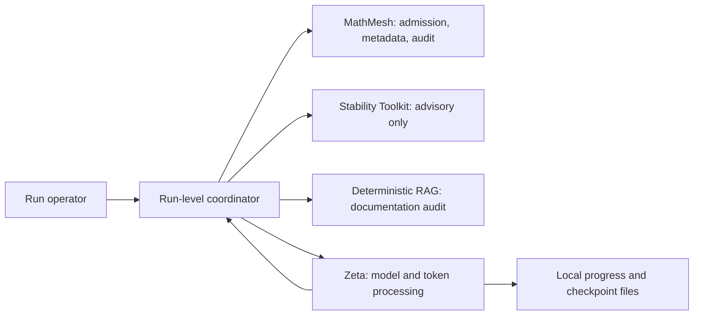

# Multi-Repository Architecture

The completed run status and measured outcomes are recorded in
[FINAL_REPORT.md](FINAL_REPORT.md) and
[100K_PIPELINE_INTEGRITY_REPORT.md](100K_PIPELINE_INTEGRITY_REPORT.md).

## Ownership boundary

Zeta is the sole owner of model loading, tokenizer stream, mathematical
processing, attention, position encoding, KV cache and positions, tensor
precision, checkpoint creation/restoration, and experiment results. The
support repositories run around Zeta and do not receive tensors, logits, cache
state, or checkpoint files.

`integration_control.py` performs run-level admission and completion calls.
It is not imported by `run_experiment.py` or `compat_adapter.py`. The static
`rag_audit_adapter.py` supplies a deterministic audit source only. The
Stability Toolkit recommendation is written to a separate JSON file and is
never applied to Zeta settings.

During the completed run, `telemetry_sidecar.py` tailed append-only progress
and sent bounded summaries to MathMesh from a separate process.
`stability_advisory_sidecar.py` read those records and appended per-checkpoint
resource recommendations to `stability-recommendations.jsonl`. Both were
separate from the inference process and cannot alter its configuration.

## Service roles

### MathMesh Governor

Pinned Node service and PostgreSQL database. The qualification registered a
run identity, issued a key, requested admission, created a `PipelineRun`
metadata row, and wrote an observational audit event. It made no model-provider
request; no model key or model endpoint was configured. The DB export is under
`support/mathmesh/mathmesh-audit.dump`.

### System-Stability-Toolkit

Pinned pure-Python advisory helper. It observed CPU and available memory and
returns buffer, concurrency, and task-size recommendations at each observed
checkpoint. Each recommendation is appended with `applied_to_zeta: false`.
Recommendations are data, not Zeta configuration.

### Deterministic RAG Governor

Pinned API service in a Python 3.11 container, with an experiment-local SQLite
database. Its static adapter records run metadata as a deterministic
run-level governed request. This use does not establish mathematical
correctness, and its citation-overlap gate is not treated as a truth test. No
RAG request is made from the Zeta token-processing path.

## Timing and failure boundary

Coordinator requests are bounded and occurred outside inference. The MathMesh
sender used its own worker thread and bounded queue; the Stability observer ran
in a separate process and performed local read-only measurements. Neither
observer received tensors, logits, cache state, or model state. Focused tests
and a telemetry sender failure injected during a short model smoke confirmed
that Zeta inference continues independently. Both observers delivered their
records through the completed run. Physical support-service outage isolation
during full-run inference was not tested; see
[NON_INTERFERENCE_RESULTS.md](NON_INTERFERENCE_RESULTS.md).
