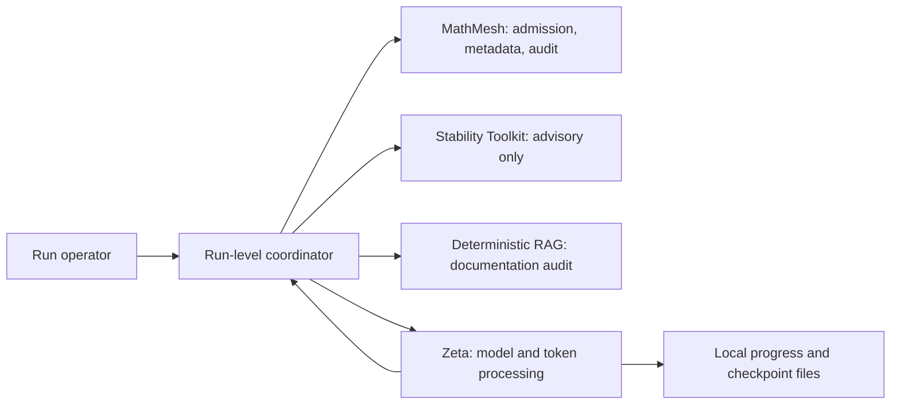

# Multi-Repository Architecture

For the later observer implementation and its qualification limits, see
[QUALIFICATION_RECHECK_20261117.md](QUALIFICATION_RECHECK_20261117.md).

## Ownership boundary

Zeta is the sole owner of model loading, tokenizer stream, mathematical
processing, attention, position encoding, KV cache and positions, tensor
precision, checkpoint creation/restoration, and experiment results. The
support repositories run around Zeta and do not receive tensors, logits, cache
state, or checkpoint files.

`integration_control.py` performs run-level admission and completion calls.
It is not imported by `run_experiment.py` or `compat_adapter.py`. The static
`rag_audit_adapter.py` supplies a deterministic audit source only. The
Stability Toolkit recommendation is written to a separate JSON file and is
never applied to Zeta settings.

## Service roles

### MathMesh Governor

Pinned Node service and PostgreSQL database. The qualification registered a
run identity, issued a key, requested admission, created a `PipelineRun`
metadata row, and wrote an observational audit event. It made no model-provider
request; no model key or model endpoint was configured. The DB export is under
`support/mathmesh/mathmesh-audit.dump`.

### System-Stability-Toolkit

Pinned pure-Python advisory helper. It observed CPU and available memory and
returned buffer, concurrency, and task-size recommendations. The complete
recommendation and timestamp are stored in `resource-recommendation.json`.
Recommendations are data, not Zeta configuration.

### Deterministic RAG Governor

Pinned API service in a Python 3.11 container, with an experiment-local SQLite
database. Its static adapter records run metadata as a deterministic
run-level governed request. This use does not establish mathematical
correctness, and its citation-overlap gate is not treated as a truth test. No
RAG request is made from the Zeta token-processing path.

## Timing and failure boundary

Service requests are only made at run-level admission and completion. Each
HTTP request has a three-second timeout. Zeta stores progress locally at its
normal checkpoint intervals. There are no network requests in forward passes.

The coordinator uses synchronous bounded HTTP requests before/after execution.
A separate asynchronous bounded progress observer has since been implemented;
its synthetic and component tests and remaining concurrent-model qualification
are described in the recheck addendum. It is not part of the forward path.

Support services can be stopped independently. However, the required
model-execution outage test did not pass its Zeta preflight because host memory
was below the model-load gate. The current evidence therefore does not certify
failure isolation during an actual run.
